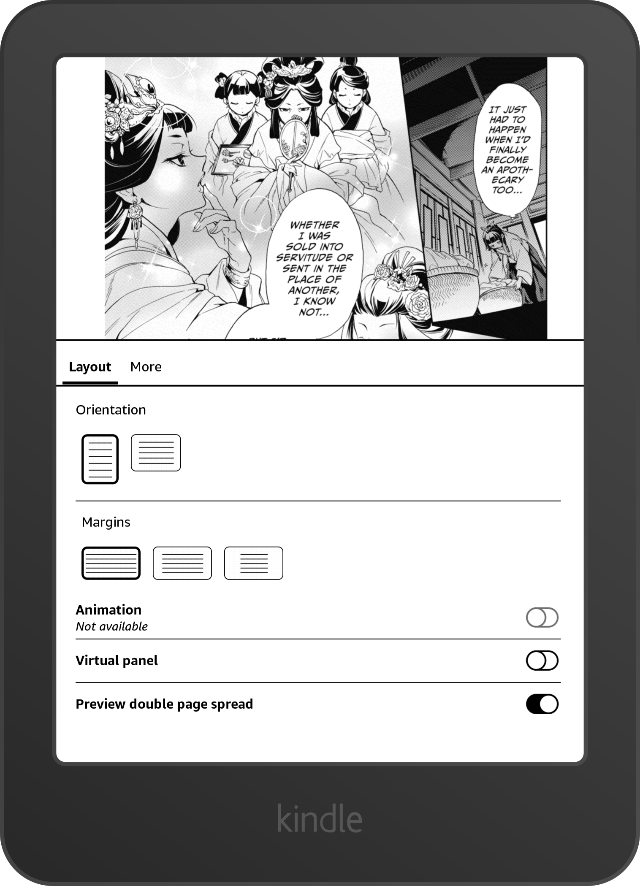
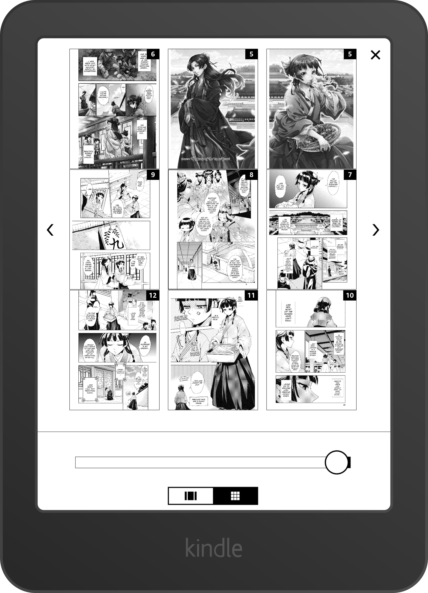

# ComicKFX

A Calibre plugin for generating Kindle-optimized KFX files from CBZ comics.

ComicKFX integrates comic-to-KFX conversion directly into Calibre, providing optimized layouts, double-page splitting,
configurable reading direction, and native Kindle reading features.

This project is based on [kckfxgen](https://github.com/Exhen/kckfxgen), with additional features and a dedicated Calibre
plugin interface.

## Why KFX?

KFX is one of the best formats for reading comics on Kindle devices because it integrates directly with the native
Kindle reader.

Unlike standard image-based formats, KFX supports Kindle-specific features that provide a better reading experience and
make full use of the device's screen.

Some of its key advantages include:

- **Full-screen reading:** Pages can use the entire screen without additional margins.
- **Double-page spreads:** Wide comic pages can be automatically split into two sequential views.
- **Landscape mode:** View complete double-page spreads in landscape orientation.
- **Native Kindle features:** Take advantage of the reading features and interface provided by the native Kindle reader.
- **Optimized reading experience:** Enjoy smooth navigation and seamless integration with the Kindle library.

## Requirements

- [Calibre](https://calibre-ebook.com/es/download)
- A Kindle device (jailbreaking is not required)
- A CBZ comic file (most importantly!)

## Installation

1. Download `generate_comic_kfx.zip`.
2. Open Calibre and navigate to **Preferences > Advanced > Plugins**.
3. Click **Load plugin from file**.
4. Select the downloaded `.zip` file.
5. Restart Calibre to complete the installation.

## Add to Toolbar

1. Go to **Preferences > Toolbars & menus**.
2. Select **The main toolbar** from the left-hand column.
3. Find **Generate Comic KFX** in the available actions.
4. Move it to the right-hand column and place it at your preferred position.

## How to Use

1. Select one or more comics in your Calibre library.
2. Click the **Generate Comic KFX** button.

A configuration window will open, allowing you to select the reading direction:

- **LTR (Left to Right)**
- **RTL (Right to Left)**

## The Result

**Single-page layouts**

Regular pages are displayed full-screen, without any additional margins.

**Double-page layouts**

For double-page spreads, the Kindle automatically splits the image into two halves and displays them sequentially.

<table>
  <tr>
    <td></td>
    <td></td>
  </tr>
</table>

**Full-page landscape view**

Double-page spreads also include a popup that allows you to view the entire page in landscape orientation.

## Additional KFK Features

The KFX format also provides access to additional Kindle features, enhancing the reading experience.

<table>
  <tr>
    <td></td>
    <td></td>
  </tr>
</table>

